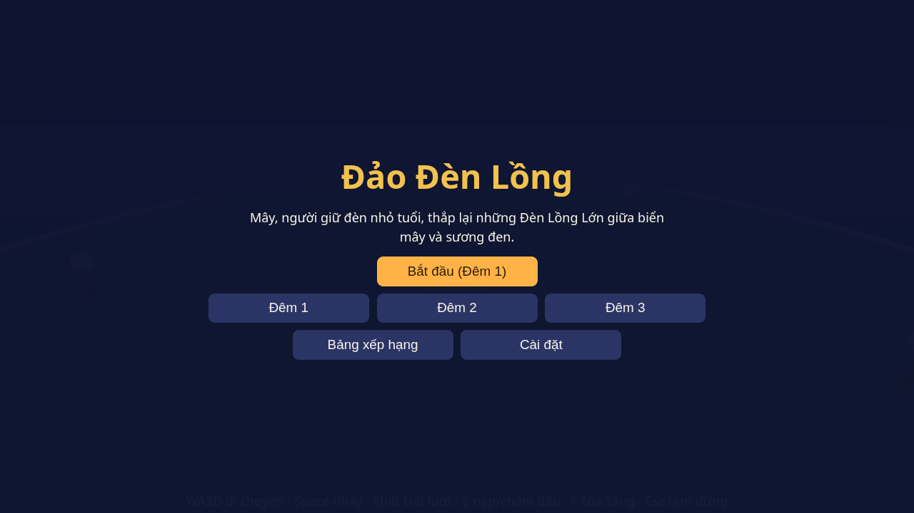
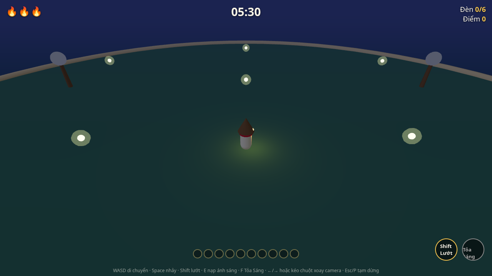
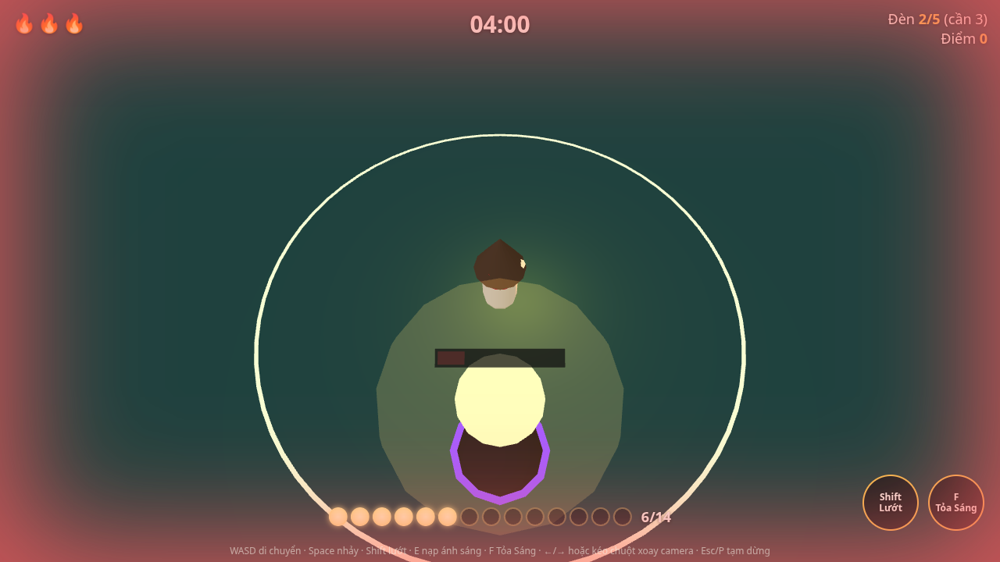

# Đảo Đèn Lồng (Day 12 AI SDLC) — Nguyễn Thị Dũng, 2A202603508

> **Video demo:** [docs/demo/demo.mp4](docs/demo/demo.mp4) (2 phút 42 giây, tự quay bằng `docs/demo/record.mjs`: Chrome headless + bot chơi game; chỉ phần game, chưa có phần terminal)
> Đề bài gốc của lab: [docs/LAB-README.md](docs/LAB-README.md)

Game 3D góc nhìn thứ ba (Three.js). Mây, người giữ đèn nhỏ tuổi, gom đom đóm để giữ cho các Đèn Lồng Lớn sáng tới bình minh, né Bóng Mực và Gió Lạc trên ba hòn đảo. Lõi mô phỏng tất định (`sim/`) dùng chung cho game, chế độ headless, benchmark và soak test.

| Menu | Đêm 2: Đảo Cau | Đèn cạn dầu (Phase 3) |
|---|---|---|
|  |  |  |

## Yêu cầu hệ thống
- **Node.js 20 trở lên** (đã chạy với v26.13.1) và `npm`. macOS hoặc Linux.
- Trình duyệt hiện đại có WebGL2 (Chrome/Chromium, Firefox, Safari). **Benchmark cần Chrome hoặc Chromium.**
- Bất kỳ GPU nào có WebGL2; đã đo trên Intel UHD (xem mục Benchmark).

## Cài đặt và chạy (3 lệnh)
```bash
git clone <repo> && cd <repo>
npm install
npm start          # mở http://localhost:8080
```
Nếu cổng 8080 bận: `node server.mjs 8081`.

## Điều khiển (đổi được trong Cài đặt → Đổi phím)
| Phím | Việc |
|---|---|
| W A S D | Di chuyển (theo hướng camera) |
| Space | Nhảy (chỉ khi chạm đất) |
| Shift trái | Lướt (14 m/s trong 0.2 s, hồi chiêu 1.5 s) |
| E | Nạp đom đóm để thắp đèn tắt, hoặc châm dầu cho đèn đang sáng (trong 2 m) |
| F | Tỏa Sáng: choáng và đẩy Bóng Mực trong 5 m, tốn 3 đom đóm, hồi chiêu 3 s |
| ← → hoặc kéo chuột | Xoay camera |
| Esc | Tạm dừng (Tiếp tục / Chơi lại Đêm / Cài đặt / Về menu) |

**Luật:** giữ ≥ 60% số đèn sáng tới bình minh (3/5, 4/6, 5/7) và còn Ngọn Lửa. Đèn hao dầu 1/giây; châm dầu bằng đom đóm (+10 mỗi đom đóm); đèn tắt thắp lại bằng 5 đom đóm. Dưới 30 dầu đèn mất vùng an toàn và bị Bóng Mực hút dầu. Sức chứa tăng 2 mỗi lần thắp (tối đa 20). Điểm: +5/đom đóm nạp, +100 thắp lần đầu, +40 thắp lại, +5 mỗi Bóng Mực trúng Tỏa Sáng (+15 nếu nó đang hút dầu); bình minh: mỗi đèn sáng +50 + phần nguyên của dầu, mỗi Ngọn Lửa +50. Toàn bộ số chuẩn nằm trong [game.contract.json](game.contract.json). Chi tiết: [SPEC-PHASE2.md](SPEC-PHASE2.md), [SPEC-PHASE3.md](SPEC-PHASE3.md), [ADR-0003](docs/ADR-0003-den-nhien-lieu-va-luat-thang.md).

## Bảng xếp hạng
Sau màn Bình Minh hoặc khi thua ở bất kỳ Đêm nào, nhập tên (3–12 ký tự `A-Za-z0-9_`, chưa hỗ trợ tiếng Việt có dấu) để lưu điểm. Top 10, lưu trong `data/leaderboard.json` (còn sau khi tắt và mở lại). Xem từ menu chính, hoặc xuất:
```bash
node server.mjs --export-leaderboard out.json   # {"entries":[...]} đúng thứ tự
```

## Trợ năng
- **Đổi phím** cho mọi hành động (4 hướng, nhảy, lướt, tương tác, tỏa sáng, tạm dừng), báo trùng phím, nút "Khôi phục mặc định"; lưu lại.
- **Phụ đề / chỉ báo hình ảnh:** Bóng Mực xuất hiện (kèm mũi tên đỏ ở mép màn hình), gió sắp thổi, 10 giây cuối, đèn sắp hết dầu.
- **Giảm chuyển động:** tắt chớp màn hình và nhấp nháy. **Bảng màu dễ phân biệt** (mù màu). **Chữ lớn ×1.25**; cỡ chữ UI tối thiểu 18 px.

## Cách chạy test
```bash
bash scripts/verify.sh     # 197 kiểm tra headless; log vào evidence/phase-4/verify.log
```
Kiểm tra gồm: định dạng và tick model, lướt/nhảy/Tỏa Sáng/Gió Lạc/Bùa Gió/gió/bục nhảy/tầng, nhiên liệu đèn và luật thắng, soak, bảng xếp hạng, cảnh benchmark, tất định, hiệu năng, và đầu vào hỏng (exit 2).

## Headless (Test Contract v1.3)
```bash
node sim/cli.mjs --seed 1 --night 1 --ticks 600 --out out.jsonl [--scenario f.json] [--inputs f.json] [--snapshot-every 10]
```
60 tick/s, đầu ra JSONL (snapshot, event, end), tất định theo seed. `--night` nhận 1, 2, 3. Đầu vào/scenario hỏng thoát với mã 2.

## Benchmark
```bash
node bench/run.mjs --seed 42 --duration 30 --out bench.json
```
Mở cửa sổ Chrome 1280×720 (không toàn màn hình), tắt vsync bằng cờ `--disable-gpu-vsync --disable-frame-rate-limit`, tải Đêm 1 đủ hiệu ứng với **200 Bóng Mực (wander) + 100 đom đóm**, L1–L3 sáng fuel 100; tắt sinh thêm, sát thương, nhặt, hao dầu, kết thúc Đêm. Camera bay vòng bán kính 30 m, Y = 15 m, 15 s/vòng; 3 s khởi động rồi đo đúng `--duration` giây. Không có màn hình thì chạy `--headless` (render phần mềm, chậm hơn nhiều).

Kết quả của tôi ([bench.json](bench.json)): **325.7 FPS trung bình, p1 low 113.4 FPS, p95 5.8 ms, 9772 khung, load 840 ms** trên Intel Core i3-1115G4 + Intel UHD (Mesa), 15 GB RAM, Linux, Chrome 157, **cửa sổ thật**. Chỉ để tham khảo; máy chấm sẽ cho số khác.
- `peak_mem_mb` = tổng RSS của mọi tiến trình Chrome (cộng cả bộ nhớ chia sẻ) nên **cao hơn bộ nhớ thật**.
- `vsync_off` ghi theo cờ đã truyền cho Chrome; trang web không tự xác minh được vsync.

## Soak test
```bash
node --expose-gc sim/soak.mjs --seed 7 --nights 10 --out soak.json
```
10 Đêm liên tiếp (Đêm 1→2→3 xoay vòng, Đêm i dùng seed 7+i, i tính từ 1), input ngẫu nhiên theo seed. Kết quả ([soak.json](soak.json)): 0 crash, `mem_start_mb` 98.4 → `mem_end_mb` 101.4 (×1.03; ngưỡng ×1.2). Lưu ý trung thực: bộ nhớ khởi động tăng 49 → ~98 MB trong vài Đêm đầu (JIT/heap) rồi đi ngang, nên `mem_start_mb` được đo **sau giai đoạn làm nóng** (chạy thử các Đêm seed riêng tới khi RSS ổn định, không tính vào kết quả) và `mem_first_load_mb` (49.2) ghi RSS trước khi làm nóng. Qua nhiều lần chạy tỉ lệ nằm trong khoảng 1.03–1.17, tức biên an toàn chỉ vừa phải. Trong thử nghiệm với input ngẫu nhiên Mây thua cả 10 Đêm (đúng kỳ vọng với người chơi ngẫu nhiên).

## Cấu trúc
`sim/` lõi mô phỏng, CLI headless, soak, cảnh bench · `web/` giao diện Three.js · `server.mjs` + `server/` server tĩnh và API bảng xếp hạng · `bench/` bộ chạy benchmark · `scenarios/` + `scripts/verify.mjs` kiểm chứng · `evidence/` bằng chứng · `docs/` ADR, retro, bằng chứng chi tiết · `AGENTS.md` harness cho agent.

## Phát hành
`bash scripts/make-release.sh` tạo `dist/dao-den-long-v1.0.0.zip` (chạy được chỉ với Node: `node server.mjs`) và có `Dockerfile` (chưa kiểm thử trong môi trường này). Xem [CHANGELOG.md](CHANGELOG.md), [CREDITS.md](CREDITS.md), [LICENSE](LICENSE).

## Sáng tạo của tôi
Gợi ý nguy hiểm chỉ ở giao diện, không đổi số chuẩn hay đầu ra headless (lõi `sim/` không biết về chúng): mũi tên đỏ ở rìa màn hình tới Bóng Mực đang đuổi ngoài tầm nhìn (≤ 18 m), mắt đỏ khi đang đuổi, viền đỏ và tiếng cảnh báo khi có Bóng Mực đang đuổi trong 10 m, vòng vàng bán kính 5 m quanh Mây khi Tỏa Sáng dùng được và sáng rõ khi có Bóng Mực trong tầm trúng của F (cùng công thức 3D với lõi). Các gợi ý này tắt trong cảnh benchmark. Cảnh kiểm chứng cố định: `/?start=1&demo=hint` ([ảnh](evidence/phase-2/ui-hint.png)).

## Trung thực về những gì chưa kiểm chứng
- **Giao diện chưa có test tự động.** Menu, tạm dừng, đổi phím khi bấm thật, chuyển Đêm, màn thắng/thua, lưu tên vào bảng xếp hạng từ giao diện, và âm thanh chưa được thao tác/nghe thử (chỉ có ảnh các màn hình và API bảng xếp hạng được kiểm tra bằng test + `curl`).
- **Video demo** chỉ quay phần game (menu, Đêm 1–3, cài đặt, bảng xếp hạng) bằng bot tự chơi; phần terminal (verify, soak, bench) chưa có, xem [docs/demo/SCRIPT.md](docs/demo/SCRIPT.md).
- Chưa đo trên máy chấm của giảng viên; chưa kiểm thử Docker.
- Số token/chi phí AI: xem [docs/RETRO.md](docs/RETRO.md) (cần tác giả bổ sung).

Bằng chứng theo từng phase: [docs/EVIDENCE.md](docs/EVIDENCE.md).
